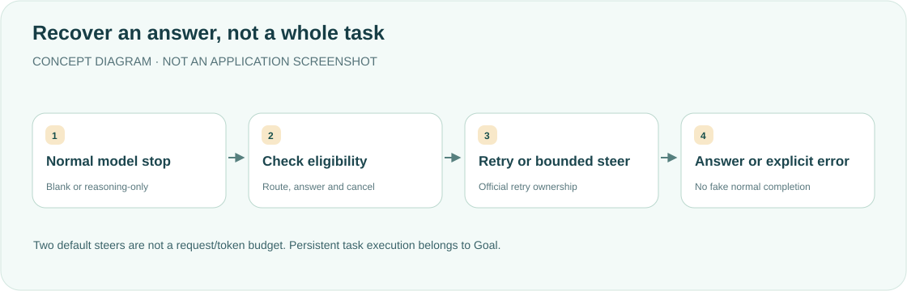

<div align="center">

<h1>xuxie · Silence is not an answer</h1>
<p><strong>Recover answerless normal stops—not unfinished natural-language tasks.</strong></p>
<p><a href="README.md">简体中文</a> · <strong>English</strong></p>
<p><a href="package.json">v0.2.2</a> · <a href="LICENSE">MIT</a> · DSH desktop plugin</p>
<p><a href="#features">Features</a> · <a href="#how-it-works">How it works</a> · <a href="#behavior-and-boundaries">Behavior</a> · <a href="#installation-and-configuration">Installation</a> · <a href="#development-and-validation">Validation</a></p>
</div>

---

Uses official Host extension points, without changing DSH core, model selection or search plugins. Empty-response errors use official retry; reasoning-only normal stops receive bounded in-turn steering. **A nonempty answer with an unfinished task is not xuxie's responsibility. Use Goal for persistent execution objectives.**

## Features

<table><tr>
<td width="33%"><strong>🧩 Official retry ownership</strong><br/><br/>Do not reconvert zero-block responses; add EMPTY_RESPONSE only for entirely blank existing blocks.</td>
<td width="33%"><strong>🔁 Bounded continuation</strong><br/><br/>Default maximum: two actual steering inputs per turn, yielding to other continuation inputs.</td>
<td width="33%"><strong>🧾 Explicit exhaustion</strong><br/><br/>Remaining reasoning-only output ends with XUXIE_NO_ANSWER, not normal completion.</td>
</tr><tr>
<td><strong>🎯 Exact routes</strong><br/><br/>Main agents and selected providers by default, excluding subagents and title/compaction requests.</td>
<td><strong>🛑 Stop boundaries</strong><br/><br/>No extra steering after cancellation, failures, tool calls, truncation or a turn-level opt-out.</td>
<td><strong>🧠 Lightweight state</strong><br/><br/>Official incremental projections and on-demand reconstruction, not complete history/reasoning retention.</td>
</tr></table>

## How it works



## Behavior and boundaries

<details>
<summary><strong>Retry, steering and lifecycle semantics</strong></summary>

- Official pi-ai in 0.2.1-alpha.2 already turns a zero-block normal stop into EMPTY_RESPONSE. xuxie uses official BlockAssembler only when existing text/reasoning blocks are all blank. Usage is retained; converted failures carry no successful replay state. Official llm-retry owns provider policy; disabled/exhausted retry remains an error.
- `agent/turn-stopping` proposes steering; `agent/pre-step` decides after downstream middleware/stop hooks. Other real inputs take priority and remove its candidate without spending budget. Exhaustion records `turn/end.reason.kind: error` and emits official `agent/error` with XUXIE_NO_ANSWER without preempting later stop hooks.
- Existing normal text/attachments prevent duplicate answers by default. Text accompanying a tool call is a tool preamble, so later reasoning-only output can still qualify.
- Defaults target main-agent xai/openai/openai-codex requests, not same-process subagents/Teams or auxiliary requests. Actual request routes, not stale agent defaults, determine eligibility.
- Cancelled/interrupted/failed attempts, tool calls and abnormal finishes do not steer. Any max-tokens result disables additional xuxie steering/blank conversion for that turn; official adapter errors/retries remain independent.
- Pending `plugin:xuxie` inputs are revalidated before model entry, including restored/reloaded candidates. Old cancelled-turn inputs are dropped; same-turn reloads recheck budget. At most one candidate per step. Stale candidates plus automatic context alone do not create a request. `enabled:false` still removes unconsumed old candidates without registering recovery/projections.
- Official session projections track incremental facts and reconstruct when needed, without snapshotEvents(), full history or reasoning text. jiyi filters plugin-origin reminders after final turn/end rather than recording them as human preferences.

</details>

`maxSteersPerTurn` counts actual entered reminders, **not total model calls, retries or tokens**. A single steer may initiate a tool chain. The current-message marker `<!-- xuxie:off -->` suppresses this plugin's steering/blank conversion for the turn, then resets. It does not disable official zero-block EMPTY_RESPONSE or global retry. Prompts still respect requested format, silence, waiting and permissions.

## Installation and configuration

Clone/copy into `$DSH_HOME/plugins/xuxie`. Merge into the desktop `cordis.patch.yml` without replacing other plugins:

```yaml
- insert:
    - id: xuxie
      name: ../../plugins/xuxie/lib/index.js
      config:
        enabled: true
        maxSteersPerTurn: 2
        includeSubagents: false
        providers: [xai, openai, openai-codex]
        models: []
        skipIfAnswered: true
```

Providers/models are exact route names; an empty list allows all and both filters must match. maxSteersPerTurn is a nonnegative integer; zero fails qualifying reasoning-only stops immediately instead of steering. Invalid/unknown configuration fails at load.

Requires official loader, agents, llm and sessionProjections. `ctx.loader.import()` reuses the Host's official LLM; do not install another implementation or copy retry/assembly code. Fully quit DSH with ⌘Q and reopen after Host changes. New turns in new/restored sessions qualify; completed history is not retroactively rewritten. Test reloads do not imply desktop hot reload.

## Development and validation

Tests prefer a read-only extracted runtime via DSH_OFFICIAL_ROOT. Otherwise they use current built files under `~/Documents/dsh-official-0.2.1-alpha.4`, overridable with DSH_TEST_ROOT. Missing dependencies/builds fail rather than skip. Fixtures use in-memory models/persistence, not online models or real sessions. Official PiAiAdapter stream tests distinguish zero from blank blocks; Host integration covers budget0/2, cancellation, existing answers, subagents, restore and same-turn reload.

```bash
node --check lib/index.js
node --check lib/detect.js
node --check lib/empty-response.js
node --test test/*.test.mjs
# 验证官方发行版，不使用旧 checkout：
DSH_OFFICIAL_ROOT=/path/to/extracted-runtime node --test test/*.test.mjs
```

<details>
<summary><strong>Version notes</strong></summary>

0.2.2 changes test paths to the current alpha.4 reference, not Host logic. 0.2.1 fixes cancelled/restored/reloaded candidate eligibility and cleanup. 0.2.0 introduced official retry ownership, explicit exhaustion, main-agent defaults, existing-answer protection and opt-out while removing full-history scans and separate in-memory counters.

</details>

**This update validates bilingual documentation, diagrams, links and layout only. Product suites were not rerun, and the desktop was not restarted.** [MIT License](LICENSE).

<div align="center"><sub>A bounded nudge—not an unlimited execution loop. · <a href="README.md">阅读中文版 →</a></sub></div>
