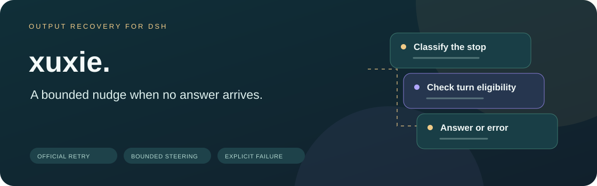
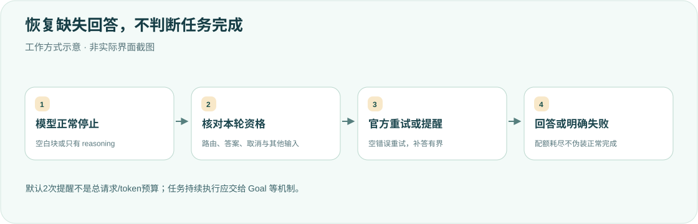

<div align="center">

<h1>xuxie · 不把沉默当答案</h1>
<p><strong>处理正常结束却没有答案的输出，不替代任务完成判断。</strong></p>
<p><strong>简体中文</strong> · <a href="README.en.md">English</a></p>
<p><a href="package.json">v0.2.2</a> · <a href="LICENSE">MIT</a> · DSH desktop plugin</p>
<p><a href="#核心能力">核心能力</a> · <a href="#工作方式">工作方式</a> · <a href="#行为与边界">行为与边界</a> · <a href="#安装与配置">安装与配置</a> · <a href="#开发与验证">开发与验证</a></p>
</div>

---

复用当前 Host 的正式扩展点，不修改 DSH 核心、模型选择或搜索插件。空响应交给官方重试；reasoning-only 正常停止才在本轮有界提醒。**已有非空正文但任务未完，不由 xuxie 接管；持续目标应使用 Goal。**

## 核心能力

<table><tr>
<td width="33%"><strong>🧩 官方重试分工</strong><br/><br/>不重复转换零内容块，仅对全空白块补充 EMPTY_RESPONSE。</td>
<td width="33%"><strong>🔁 有界补答</strong><br/><br/>默认每轮最多2次实际入模提醒，其他继续输入优先。</td>
<td width="33%"><strong>🧾 不伪装完成</strong><br/><br/>仍只有思考且配额耗尽时明确 XUXIE_NO_ANSWER，不正常结束。</td>
</tr><tr>
<td><strong>🎯 路由精确匹配</strong><br/><br/>默认主代理与指定提供方，排除子代理和标题/压缩辅助请求。</td>
<td><strong>🛑 尊重停止边界</strong><br/><br/>取消、异常、工具调用、截断及本轮静默标记不额外催促。</td>
<td><strong>🧠 轻量状态</strong><br/><br/>官方增量投影与按需重建，不扫描或持有全部历史思考。</td>
</tr></table>

## 工作方式




## 行为与边界

- **空输出分工**：官方 0.2.1-alpha.2 的 pi-ai adapter 已把零内容块的正常 `stop` 转为 `EMPTY_RESPONSE`，xuxie 不重复转换零块输出，也不改写官方错误。仅当存在一个或多个正文／思考块且全部为空或空白、仍为正常 `stop` 时，才使用官方 `BlockAssembler` 补充 `EMPTY_RESPONSE`。官方 `llm-retry` 按 provider 的重试策略处理；重试未启用、禁用此错误或耗尽时，明确报错。保留用量；本插件转换的失败响应不携带成功 replay state。
- **只有思考**：`agent/turn-stopping` 放入候选提醒；`agent/pre-step` 在其他停止钩子和下游 middleware 处理后决定是否保留。已有其他继续输入时让其优先，移除自己的候选，不消耗续写次数。
- **续写耗尽**：仍只有思考时记录 `turn/end.reason.kind: error`，错误码 `XUXIE_NO_ANSWER`，并通过官方 `agent/error` 显示失败；不再以正常完成结束。此判定不会抢在后置 Stop hook 之前阻止它接管。
- **已有回答**：默认不重复补写本轮之前已经给出的正常正文或附件。带 tool-call 的文字视为工具前说明，仍允许后续只有思考时补答。
- **作用范围**：默认只处理主代理的 `xai`、`openai`、`openai-codex` 路由。默认排除同进程子代理／Agent Teams 成员；不会干预会话标题、压缩等辅助模型请求。
- **取消与截断**：取消、interrupted、失败 attempt、工具调用和非正常 finish 不触发续写；本轮任何一步发生 `max-tokens` 后，xuxie 不再额外续写或将空白响应转换为错误。官方 adapter 自身产生的错误及其重试不受此开关控制。
- **候选生命周期**：入模前按 `plugin:xuxie` 来源重新验证所有待处理提醒，不依赖进程内候选身份。取消后保留的旧提醒在下一轮或恢复会话时丢弃；当前轮重载仍重新检查资格与配额。同一步至多保留一条提醒，其他实际输入优先；只有过期提醒和自动 runtime context 时不发起模型请求。`enabled: false` 仍清理尚未消费的本插件提醒，但不注册续写、空响应处理或状态投影。
- **状态读取**：官方 session projection 增量维护本轮事实，恢复／重载时按需重建；不调用 `snapshotEvents()`，不持有完整历史、思考文本或流数据。
- **消息来源**：提醒使用 `plugin:xuxie`。本机 `jiyi` 在最终 `turn/end` 后采集并过滤插件来源，避免把提醒记作人类偏好。

这是输出恢复插件，不判断自然语言任务是否完成。模型已经写了一段非空正文，即使任务还没做完，也不由它继续催促；持续执行目标交给 Goal 等官方机制。一次续写可以引出工具链、多次模型请求和官方重试，`maxSteersPerTurn` 限制的是实际进入会话的插件提醒次数，不是总调用／token 预算。

用户需要有意保持静默或等待时，可在当前消息中加入 `<!-- xuxie:off -->`，该轮 xuxie 既不补答，也不把空白响应转换为错误；下一轮自动恢复。也可以通过配置关闭插件。该标记不是 DSH 全局静默或重试开关：官方 pi-ai adapter 对完全没有内容块的响应仍会产生 `EMPTY_RESPONSE`，官方重试仍按 provider 策略执行。续写提示本身仍要求模型遵守用户的格式、静默、等待及权限要求。

## 安装与配置

目录放在 `$DSH_HOME/plugins/xuxie`，在当前 profile 的 `cordis.patch.yml` 添加：

```yaml
- insert:
    - id: xuxie
      name: ../../plugins/xuxie/lib/index.js
      config:
        enabled: true
        maxSteersPerTurn: 2
        includeSubagents: false
        providers: [xai, openai, openai-codex]
        models: []
        skipIfAnswered: true
```

`providers` 与 `models` 为实际模型路由的精确名称，空列表表示允许所有；两项都满足才处理。来源以真实模型请求为准，不依赖可能被 middleware 改写前的 agent 默认设置。`maxSteersPerTurn` 必须是非负整数；设为 0 时不发续写请求，遇到需要补答的正常 reasoning-only 输出直接显式失败。未知配置键或无效值在加载时明确报错。

需要当前 Host 的 `loader`、`agents`、`llm`、`sessionProjections` 服务。通过正式 `ctx.loader.import()` 复用该 Host 的官方 LLM 实现，不安装另一套 LLM 或复制组装／重试逻辑。

桌面端更新后必须完全退出 DeepSeek Harness（macOS：⌘Q）再打开，刷新网页不会重新加载 Host 插件。新会话和恢复的旧会话的后续轮次都生效；不追溯补写已结束的历史输出。测试中的插件重载用于验证 Host 生命周期边界，不代表桌面端会自动热更新。

## 0.2.2 测试路径维护

默认测试依赖改为现用的 `~/Documents/dsh-official-0.2.1-alpha.4`，解除对已淘汰 alpha.2 checkout 的依赖；保留 `DSH_OFFICIAL_ROOT` 和 `DSH_TEST_ROOT` 覆盖。本次不改 Host 运行逻辑，不需要为测试路径变更重启桌面端。

## 0.2.1 修复

修复取消保留队列、会话恢复和候选窗口重载时旧提醒绕过资格／配额校验的问题；配置关闭时仍清理遗留提醒；合并重复候选并避免仅由过期提醒附带的 runtime context 触发请求。澄清静默标记不关闭官方 adapter 的原生空响应错误与重试。

## 0.2.0 行为变化

新增真正空输出的官方重试入口；续写耗尽变为显式错误；默认仅主代理及列出的 providers 生效；默认避免重复已有回答，并支持本轮静默标记。移除旧全量历史扫描与独立内存计数器。

## 开发与验证

测试优先使用 `DSH_OFFICIAL_ROOT` 指定的只读发行目录（含 `node_modules/@deepseek-ai/*`）。未设置时复用现用 DSH checkout 的当前构建文件，默认 `~/Documents/dsh-official-0.2.1-alpha.4`，可用 `DSH_TEST_ROOT` 指定。缺失构建或依赖会失败，不会静默跳过 Host 验收。模型和持久化使用内存 fixture，不调用在线模型、不读真实用户会话。另直接运行官方 `PiAiAdapter.streamWithSnapshot()` 与伪造上游流，证明零块已由官方处理、空白块才需要增量保护；Host 集成覆盖配额 0/2、取消、已有答案、子代理排除、持久化恢复与同轮重载。

```bash
node --check lib/index.js
node --check lib/detect.js
node --check lib/empty-response.js
node --test test/*.test.mjs
# 验证官方发行版，不使用旧 checkout：
DSH_OFFICIAL_ROOT=/path/to/extracted-runtime node --test test/*.test.mjs
```

<details>
<summary><strong>为什么模型有正文，但任务没做完时不续写？</strong></summary>

xuxie 负责缺失回答，不判断自然语言目标是否完成。已有非空正文后，持续执行应由 Goal 等机制负责；一次提醒也可能产生多次工具/模型调用，提醒配额不是总 token 预算。

</details>

**本次为文档更新：仅核对双语、图示、链接和排版，未重跑产品测试或重启 DSH。** [MIT License](LICENSE)。

<div align="center"><sub>有边界地提醒，不无限循环。 · <a href="README.en.md">Read in English →</a></sub></div>
